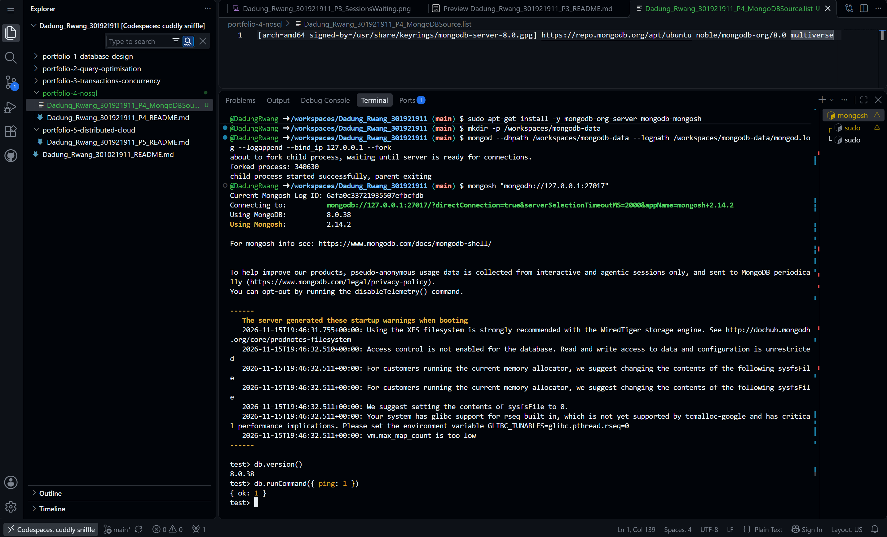

# MongoDB Setup

MongoDB runs locally in the existing Ubuntu 24.04.5 Codespace alongside PostgreSQL. The MongoDB server version is 8.0.38, and the MongoDB Shell version is 2.14.2.

The database files are stored in `/workspaces/mongodb-data`, outside the Git repository. The server is configured to accept local connections through `127.0.0.1` on port `27017`.

## Start and Connect

The following commands start the MongoDB server and connect to it:

```bash
mkdir -p /workspaces/mongodb-data

mongod --dbpath /workspaces/mongodb-data --logpath /workspaces/mongodb-data/mongod.log --logappend --bind_ip 127.0.0.1 --fork

mongosh "mongodb://127.0.0.1:27017"
```

## Connection Check

The MongoDB version was verified using:

```javascript
db.version()
```

Actual result:

```text
8.0.38
```

The connection was tested using:

```javascript
db.runCommand({ ping: 1 })
```

Actual result:

```javascript
{ ok: 1 }
```

Both checks completed successfully, confirming that MongoDB was running and accepting connections.



## Reference

[MongoDB 8.0 Installation Guide for Ubuntu](https://www.mongodb.com/docs/v8.0/tutorial/install-mongodb-on-ubuntu/)